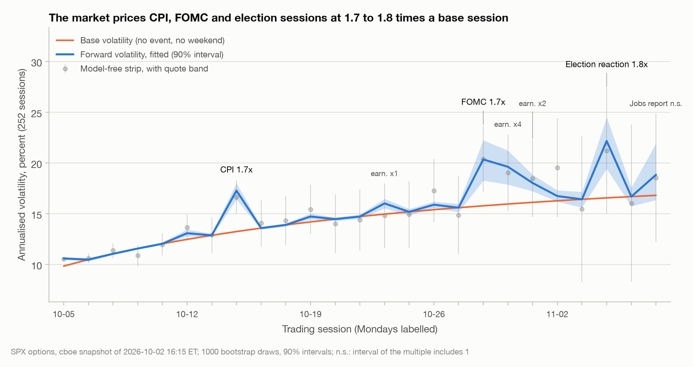
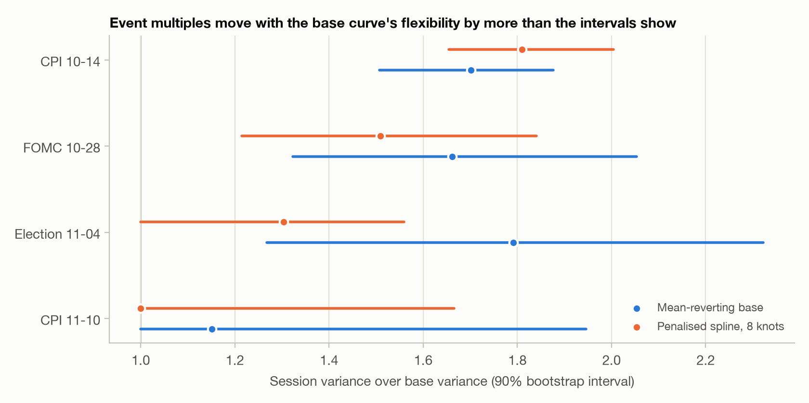
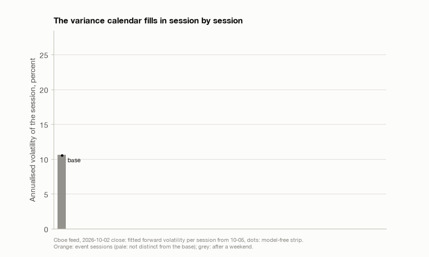
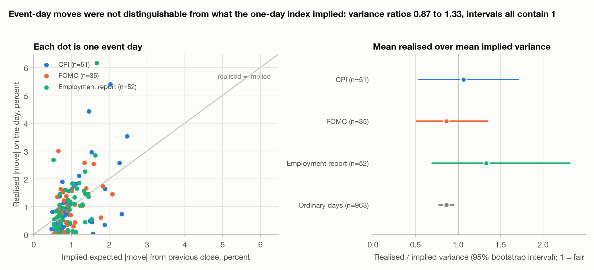
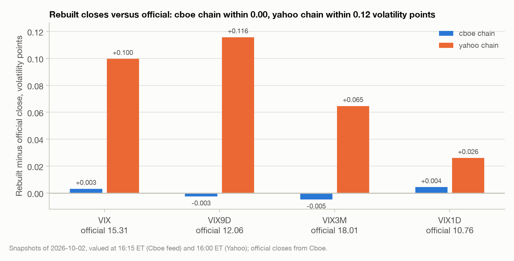
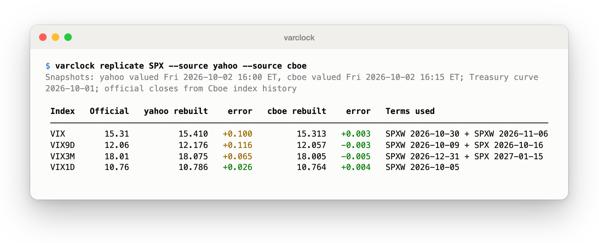
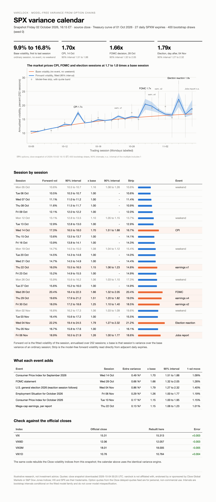
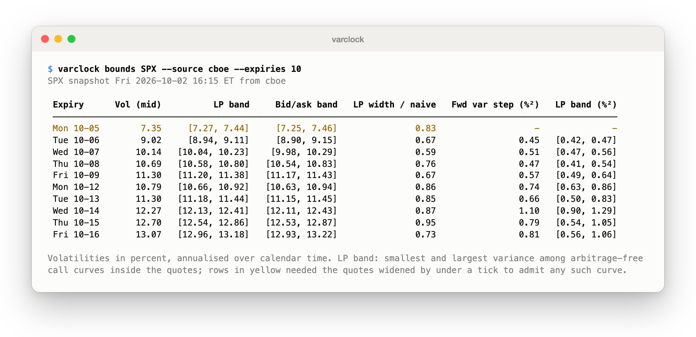

# varclock

The market's variance calendar: how much volatility S&P 500 options price for every single trading day, event and weekend ahead, read model-free from one option-chain snapshot.

[](https://github.com/Thesimpleex/varclock/actions/workflows/ci.yml)


<picture>
  <source media="(prefers-color-scheme: dark)" srcset="docs/animations/calendar-dark.svg">
  
</picture>

*Snapshot of the Friday 2026-10-02 close, Cboe delayed-quotes feed (`--source cboe`; the default Yahoo Finance adapter gives the same picture, see below). The terminal needs about 112 columns for the full table; narrower windows drop the strip and bar columns. Illustrative research, not investment advice.*

## Why this matters

Volatility is not spread evenly over the calendar. A weekend carries little variance; an FOMC decision, a CPI release or an election carries a lot. Desks keep this "variance clock" in spreadsheets, and the retail rule "straddle price equals expected move" mixes event jumps with ordinary diffusion. Since S&P 500 (SPX) options now expire on every trading day, the whole calendar can be read from one snapshot of the chain: the difference between two adjacent daily expirations is the variance the market charges for the sessions in between.

varclock does three things. It rebuilds the Cboe volatility-index methodology exactly, with tests against Cboe's own worked examples and against the official closes. It turns the strip of daily expirations into forward variances per session with arbitrage checks. And it fits a variance clock, a smooth base rate plus event bumps and a weekend weight, with bootstrap intervals. It is meant for volatility traders and derivatives quants who need event variance and weekend weights from today's chain, for risk managers who want the expected move around CPI or FOMC separated from ordinary diffusion, and for students who want a validated, documented implementation of model-free variance.

## Key results

All numbers below come from `docs/results.json`. Snapshots were downloaded on Sunday 2026-10-04 and hold the quotes of the Friday 2026-10-02 close (Cboe feed valued at 16:15 ET, Yahoo Finance valued at 16:00 ET).

### The calendar

<picture>
  <source media="(prefers-color-scheme: dark)" srcset="docs/figures/calendar-dark.png">
  
</picture>

*Figure 1. Fitted forward volatility per session from 27 daily SPXW expirations (Cboe feed, 2026-10-02 16:15 ET), 90% bootstrap interval (1,000 draws, seed 0), base volatility without events and weekends, and the model-free strip with its quote band. n.s.: the interval of the multiple includes 1.*

- The base volatility rises from 9.9% on the first session to 17.1% on the 27th: the base is not flat, as the VIX9D (12.06) and VIX3M (18.01) closes already suggest.
- CPI on 14 October is priced at 1.70 times a base session (90% interval 1.51 to 1.88; extra variance 0.49 %², a one-standard-deviation move of 1.09%). The FOMC decision on 28 October is 1.66 times (1.32 to 2.04, move 1.28%). The session after the 3 November midterm election is 1.79 times (1.27 to 2.34, move 1.40%). The November jobs report (6 November, 1.26 times, 1.00 to 1.77) and the 10 November CPI (1.15 times, 1.00 to 1.95) have intervals that touch the lower bound of 1 and are not distinguishable from an ordinary session.
- A weekend carries 0.07 of a base session (0.04 to 0.12): the fitted Monday sessions are priced 6% to 17% above Tuesday to Friday (multiples 1.06 to 1.17, highest on the first Monday and after the last weekend of the horizon), not at three days' worth. The weekend is the least robust number of the decomposition: it ranges from 0.04 to 0.15 of a base session across base families, strike coverage and adapters (below).
- Mega-cap earnings add 1.15 times a base session per report (1.06 to 1.24), using Yahoo's announced or projected dates for the ten largest of 18 hand-picked mega-caps (by market capitalisation on 2026-10-04).
- The Yahoo chain gives the same picture for the large events: CPI 1.67, FOMC 1.81, election 1.79 times (election interval 1.00 to 2.56) and a weekend weight of 0.11.

*How robust is the decomposition?* Not very, and the intervals do not show it: they condition on the model family. With a flexible penalised spline for the base instead of the three-parameter mean-reverting curve, the CPI multiple is 1.81 (1.77 to 1.83 across three spline settings) and the FOMC multiple 1.51 (1.49 to 1.54): these two events stand out in every specification. The election multiple falls to 1.30 (1.26 to 1.39) with intervals that reach 1.00, and the two November events (jobs report, 10 November CPI) get a multiple of exactly 1.00: once the base can bend, 27 expirations do not identify them. The weekend weight depends on the specification as well: 0.07 in the default, 0.04 to 0.05 with the splines, and 0.11 when each increment is computed on the strike window common to the two expirations (Yahoo chain: 0.11, 0.06 to 0.07, 0.15). Of these, the common-window variant is the least trustworthy: on synthetic chains with a known truth and zero-bid truncation it overstates the weekend weight by 35% to 58%, while each expiry's own strike range is within 1% to 6% (Validation). Even so, "about 0.04 to 0.15" is the honest range, and "about 0.07" is the default estimate for this snapshot.

<picture>
  <source media="(prefers-color-scheme: dark)" srcset="docs/figures/robustness-dark.png">
  
</picture>

*Figure 2. Event multiples under two base specifications, same data (Cboe feed).*

Daily resolution fades with distance: the quote band of the forward variance exceeds half of the increment itself from the 17th session and the whole increment from the 22nd. Beyond about three weeks the calendar is a smooth curve with events, not a day-by-day measurement.

<picture>
  <source media="(prefers-color-scheme: dark)" srcset="docs/animations/variance-clock-dark.gif">
  
</picture>

*The calendar of Figure 1 as it is read: one bar per session (fitted forward volatility, Cboe feed, 2026-10-02 close), the base curve without events and weekends, and the model-free strip as dots. Event sessions are orange, sessions after a weekend grey.*

### Does the market price events correctly?

<picture>
  <source media="(prefers-color-scheme: dark)" srcset="docs/figures/event_study-dark.png">
  
</picture>

*Figure 3. Implied variance for the next session from the previous 16:15 close of the one-day index, against the realised S&P 500 close-to-close move, 2022-05-16 to 2026-10-02 (VIX1D history starts in May 2022; values before the April 2023 launch are Cboe's historical back-calculation).*

| Sample | n | Implied 1-sd move | Realised / implied variance | 95% interval | Premium (%²) | 95% interval |
|---|---|---|---|---|---|---|
| CPI | 51 | 1.28% | 1.06 | 0.54 to 1.71 | -0.13 | -1.48 to 0.92 |
| FOMC | 35 | 1.21% | 0.87 | 0.51 to 1.35 | 0.23 | -0.54 to 0.90 |
| Employment report | 52 | 1.16% | 1.33 | 0.70 to 2.31 | -0.50 | -2.05 to 0.45 |
| Ordinary days | 963 | 0.96% | 0.86 | 0.78 to 0.95 | 0.15 | 0.06 to 0.23 |

With 35 to 52 events per type the event variance risk premium cannot be told from zero: every interval contains a ratio of one. Ordinary days show a premium of about 14% of implied variance (realised variance 0.86 of implied, interval 0.78 to 0.95). That claim depends on the interval method: the ordinary-day rows use a circular block bootstrap with 20-session blocks (the sample is a run of consecutive days), and the premium series has a lag-1 autocorrelation of -0.24, because implied variance reacts to the previous day's realised move, so blocks give the interval 0.06 to 0.23 %²; resampling single days would give -0.04 to 0.31. A related, more stable comparison is the event day against an ordinary day: the one-day index priced a CPI day at 1.84 times an ordinary day on average (95% interval 1.24 to 2.65) and the CPI days realised 2.26 times (0.97 to 4.27); for FOMC days the figures are 1.52 (1.04 to 2.20) and 1.52 (0.83 to 2.56). Today's calendar multiples of 1.70 for CPI and 1.66 for FOMC are session variance over a fitted base session, the historical figures are event-day variance over the average ordinary day (which includes Mondays and their weekend variance), so the two are only roughly comparable; both calendar multiples lie within the 95% intervals of the historical average implied multiples.

### Rebuilt versus official indices

<picture>
  <source media="(prefers-color-scheme: dark)" srcset="docs/figures/replication-dark.png">
  
</picture>

*Figure 4. Rebuilt minus official close, volatility points, same snapshot date, Cboe index history as the reference.*

| Index | Official close | Cboe feed | Error | Yahoo chain | Error |
|---|---|---|---|---|---|
| VIX (30 days) | 15.31 | 15.313 | +0.003 | 15.410 | +0.100 |
| VIX9D | 12.06 | 12.057 | -0.003 | 12.176 | +0.116 |
| VIX3M | 18.01 | 18.005 | -0.005 | 18.075 | +0.065 |
| VIX1D | 10.76 | 10.764 | +0.004 | 10.786 | +0.026 |

The Cboe feed reproduces all four closes to within 0.01 volatility points; the 30-day and three-month terms cross the 1 November change from daylight-saving to standard time, which the real-elapsed-time convention (Convention choices) accounts for. The Yahoo chain is 0.03 to 0.12 points too high. Truncation of the chain is not the cause: running the Cboe quotes on the strike set that Yahoo lists changes the four values by at most 0.005 (VIX 15.308, VIX9D 12.057, VIX3M 18.005, VIX1D 10.761). The cause is the quote vintage. Yahoo's near-the-money quotes imply a forward equal to the 16:00 index close, while the Cboe feed at 16:15 shows a forward 6.6 points higher, so varclock values the Yahoo snapshot at 16:00; valued at 16:15 its errors would be +0.103, +0.126, +0.066 and +0.231. The one-day index is the most sensitive to this.

<picture>
  <source media="(prefers-color-scheme: dark)" srcset="docs/screenshots/replicate-dark.png">
  
</picture>

### The HTML report

<picture>
  <source media="(prefers-color-scheme: dark)" srcset="docs/screenshots/report-dark.png">
  
</picture>

`varclock report SPX --out variance-calendar.html` writes a single self-contained page (inline style, embedded figure) with the calendar, the event table and the check against the official closes.

### Arbitrage-free bands (should-have extension)

The published index uses mid quotes. `varclock bounds` computes, for every daily expiration, the smallest and largest variance among call-price curves that lie inside the bid-ask quotes and admit no static arbitrage, with the forward as a free variable (two linear programs per expiry, HiGHS). On the Cboe snapshot the band is on average 0.83 times as wide as the plain all-bid to all-ask band (smallest ratio 0.59); on the Yahoo chain 0.91 (0.73). One expiry on each feed (the first, one-day) needed its quotes widened, by 0.007 and 0.004 index points, to admit any arbitrage-free curve at all.

<picture>
  <source media="(prefers-color-scheme: dark)" srcset="docs/screenshots/bounds-dark.png">
  
</picture>

## Method

**Model-free variance of one expiration.** With forward $F$, time to expiry $T$ (years), rate $R$, and $K_0$ the first strike at or below $F$, the Cboe formula is

$$
\sigma^2 = \frac{2}{T}\sum_i \frac{\Delta K_i}{K_i^2}\, e^{RT}\, Q(K_i) \;-\; \frac{1}{T}\left(\frac{F}{K_0}-1\right)^2 ,
$$

where $Q(K_i)$ is the mid of the out-of-the-money option at $K_i$ (average of call and put at $K_0$) and $\Delta K_i$ half the distance between the neighbouring selected strikes. It is the discrete form of the log-contract replication of variance swaps (Neuberger 1994; Carr and Madan 1998; Demeterfi, Derman, Kamal and Zou 1999). The forward comes from the strike with the smallest call-put mid difference, $F = K^* + e^{RT}(C-P)$; strikes are taken outward from $K_0$ until two consecutive options have a zero bid. The risk-free rate is a natural cubic spline through Treasury par yields clipped between neighbouring yields and converted from bond-equivalent yield to a continuously compounded rate. Constant-maturity indices interpolate total variance between a near and a next term,

$$
\text{VIX} = 100\sqrt{\left[T_1\sigma_1^2\,\frac{M_{T_2}-M_{CM}}{M_{T_2}-M_{T_1}} + T_2\sigma_2^2\,\frac{M_{CM}-M_{T_1}}{M_{T_2}-M_{T_1}}\right]\frac{M_{365}}{M_{CM}}} ,
$$

with minute counts $M$. The one-day index counts business minutes of a 6.75-hour session: 102,060 a year and 390 minutes to the next close from the 16:15 close.

**Forward variance strip.** For total variance $w_j=\sigma_j^2T_j$ of consecutive daily expirations, $v_j=(w_{j+1}-w_j)/(T_{j+1}-T_j)$; a negative value is a calendar arbitrage. Cboe's truncation rule gives adjacent expirations different strike ranges. By default each total is computed on the expiration's own selected strikes, so the increment is a plain difference of totals and the small wing variance that truncation leaves out is not removed from the later expiration. The alternative (`--coverage common`) recomputes both totals on the strike window common to the two expirations; it removes wing variance of the later expiration, and on synthetic chains with a known truth it biases the cumulative variance down and the weekend weight up, so it is a sensitivity check here, not the default.

**Variance clock.** The total variance up to expiration $j$ is explained as a sum over sessions $s$,

$$
w_j=\sum_{s\le j}\Big[f_s\,b(s)+W\,\mathrm{weekend}_s+H\,\mathrm{holiday}_s+\sum_e J_e\,x_{e,s}\Big],
$$

with a smooth non-negative base variance $b$ (mean-reverting $b_0e^{-ks}+b_\infty(1-e^{-ks})$, or a penalised spline), session fraction $f_s$ for intraday snapshots, weekend and holiday variance $W$ and $H$, and one non-negative bump $J_e$ per FOMC, CPI, employment and election event (one per-name bump for earnings). Everything is linear in the parameters, so the fit is a weighted non-negative least-squares problem with weights from the bid-ask half-widths and a 2% relative floor. Intervals are percentile intervals of a bootstrap that redraws every option price inside its bid-ask band, with the bid-ask positions of one expiration correlated (Gaussian copula, correlation 0.5, an assumption rather than an estimate, so that errors common to a whole chain do not average out over hundreds of strikes), resamples the standardized residuals and refits. Quote noise and residual noise contribute interval widths of similar size (the 90% interval of the 14 October CPI multiple is 0.26 wide with quote noise only, 0.25 with residuals only and 0.37 with both); the earlier version with independent price draws gave resampled quote noise of 0.1% to 0.3% of the total variance against a quote band of 1.8% to 3.3%, and with the correlation it is 0.7% to 1.4%. Derivations and conventions are in [`docs/methodology.md`](docs/methodology.md).

**Event study.** Implied variance of the next session is $(\mathrm{VIX1D}/100)^2\cdot 390/102{,}060$ from the previous close; realised variance is the squared close-to-close log return.

## What is standard and what is new here

Tested here, not new: the treatment of strike coverage between adjacent daily expirations, where an intersection window that looks natural turned out to bias the weekend weight (Validation).

Standard: the variance-swap replication and every convention of the volatility-index calculation, which varclock follows from Cboe's published methodology; the bid-ask LP idea (static-arbitrage polytopes for option prices); non-negative least squares; the bootstrap.

New here, in the sense of an implementation and a combination rather than a theory: an open, tested rebuild of the VIX family from a free snapshot, the joint fit of base, weekend and event terms to the whole daily strip with bootstrap intervals, and the arbitrage-free band for the variance estimate. The economics it builds on is in the literature (Section References); varclock does not claim a new result about announcement premia. The event multiples are descriptive decompositions of one snapshot, not forecasts.

## Installation

```bash
git clone https://github.com/Thesimpleex/varclock.git
cd varclock
python -m venv .venv && source .venv/bin/activate
pip install -e ".[yahoo,plot]"        # Yahoo adapter and the report/figures
```

The core needs only numpy, scipy and rich. Set a declared User-Agent for the public data sources (BLS and others require one): `export VARCLOCK_USER_AGENT="Your Name you@example.org"`. Downloads are cached in `~/.cache/varclock` (or `$XDG_CACHE_HOME/varclock`; override with `VARCLOCK_DATA_DIR`), independent of the working directory. The reproduction scripts use `data/raw/` in the repository, which is gitignored.

## Quickstart

```bash
varclock snapshot SPX                 # download and cache the chain (Yahoo Finance by default)
varclock calendar SPX                 # forward volatility per session, intervals, events
varclock replicate SPX --source yahoo --source cboe
varclock events --history             # implied versus realised on past CPI/FOMC/jobs days
varclock calendar SPX --json          # the same calendar as JSON (also: varclock events --json)
varclock bounds SPX --source cboe     # arbitrage-free variance bands
varclock report SPX --out variance-calendar.html
```

The same from Python:

```python
from varclock import build_calendar
from varclock.loaders import obtain_curve, obtain_snapshot

snap = obtain_snapshot("yahoo")  # cached or downloaded
result = build_calendar(snap, obtain_curve(snap), n_boot=400, seed=0)
for event in result.event_rows:
    print(
        event.key,
        round(event.multiple, 2),
        (round(event.multiple_lo, 2), round(event.multiple_hi, 2)),
    )
```

`varclock calendar` uses the newest cached snapshot and says when it is older than the last completed session; add `--refresh` to download a new one. Outside trading hours quotes are frozen at the last close, and varclock records the download time and the valuation time of every snapshot.

## Reproduce all results

```bash
pip install -e ".[dev,docs]"
python scripts/reproduce_all.py          # figures, docs/results.json (about ten seconds with a warm cache)
python scripts/make_screenshots.py       # screenshots, terminal cast and method animation (needs Google Chrome)
python scripts/build_calendars.py        # optional: rebuild the committed event calendars
```

`reproduce_all.py` downloads the official index histories and, if the cache is empty, the option chains; it then writes every figure to `docs/figures/` and every number quoted here to `docs/results.json` together with package versions and data vintage. Each experiment is also a script of its own (`scripts/exp_*.py`). Raw option quotes are never committed, so the calendar, replication and bounds numbers describe the snapshots of 2026-10-02 and a later run reports the later market. The historical event study depends only on free index histories and the committed calendars. The test suite runs offline in about half a minute, and `tests/data/clock_input_2026-10-02.json` (written by `scripts/freeze_clock_input.py`) freezes the derived strip totals so that the headline event multiples are regression-tested without any quotes; that test pins the implementation, it is not an independent reference.

## Validation

- **Cboe's worked examples.** For the sample VIX calculation of the methodology (27 September 2022, 10:45:15 ET), minutes (34,484 and 44,954), rates (0.031664% and 0.028797%), forwards, $K_0=1960$, all 146 and 122 per-strike contributions (within 5e-11 of the printed values), both term variances (within 5e-10) and the index (13.927842 against 13.927842 printed, within 4e-7) are reproduced. For the sample one-day index the minutes (300 and 705), forwards, variances and the level 12.58046 (within 5e-6) are reproduced. The option tables were transcribed from the methodology PDFs into `tests/data/`, for testing only.
- **Black-Scholes limit.** A flat smile gives $\sigma^2T$; the replication error falls by a factor of 4.00 per halving of the strike spacing, and truncation error vanishes as the range widens.
- **Heston.** On Fourier-priced Heston chains the replicated variance converges to $\theta T+(v_0-\theta)(1-e^{-\kappa T})/\kappa$, again by a factor of 4.00 per halving of the grid. The discretisation error is the same as in the flat-smile case to six digits, as expected: its leading term comes from the kink at $K_0$ and does not depend on the model. The Heston test therefore adds the check that the converged level matches the closed form $\theta T+(v_0-\theta)(1-e^{-\kappa T})/\kappa$.
- **Clock fit.** On analytic totals the fit recovers base, weekend and event variance to about 2e-15 relative error; through Black-76 chains and the whole pipeline to 4.5e-5 (event), 5.4e-4 (weekend) and 1.9e-5 (base); the tests assert 1e-4, 1e-3 and 1e-4.
- **Truncated chains.** With zero-bid truncation (options priced below a tick of 0.05 or 0.10 index points have no bid) and a known weekend weight, totals on each expiry's own strike range are within 0.6% and 1.5% of the truth and the weekend weight within 1% and 6%; the common-window totals are off by 4.3% and 6.9% and the weekend weight by +35% and +58% (at a tick of 0.30: 6.0% and 15.4%, weekend -28% and +112%).
- **Invariants.** Non-negative fitted variances, session variances adding up to each expiry's total, unchanged variance when zero-bid strikes are appended, a calendar-arbitrage flag.
- **Official closes.** The table above (an integration script, not a unit test).

## Limitations and next steps

- **Snapshot dependence.** Everything describes one moment, a Friday close after a weekend of no news. Event multiples will differ day to day, and a snapshot taken in the middle of the session mixes quote times across strikes.
- **Free chains.** Yahoo's quotes are 0.03 to 0.12 volatility points off the official closes in this snapshot, patchy (two of the 23 daily expirations of the Yahoo chain, 16 and 29 October, had no usable quotes at the forward strike and were skipped) and stop at the 16:00 equity close. The Cboe feed is accurate but licensed for personal, non-commercial use only.
- **Model dependence.** The decomposition into base and event is conditional on the base family (see Figure 2), and the earnings dates are announced or projected, not confirmed. The bootstrap does not cover model misspecification.
- **Quote bootstrap.** The correlation of quote errors within an expiry (0.5) is a modelling choice; the intervals scale with it. Intraday use of the Yahoo and Cboe adapters (valuation time download time minus 15 minutes) has not been validated against live quotes: every result here describes post-close snapshots.
- **Event calendars** end in 2027 for FOMC (published by the Federal Reserve), at 10 December 2026 for CPI and 4 December 2026 for the employment report (BLS had not published 2027), and at the 2028 election; earnings dates cover only the next quarter. The calendar warns when a file ends before the last expiry.
- **VIX1D history.** The one-day index was launched in April 2023; its values from May 2022 to its launch are Cboe's historical back-calculation, not prices disseminated at the time (roughly the first eleven months of the study).
- **Daily resolution** fades beyond about three weeks, because quote bands grow relative to the increments.
- **Small event samples.** About 35 FOMC meetings and about 50 CPI and employment releases since May 2022; intervals are wide and a ratio of one cannot be excluded for any type. Four employment-report days follow a weekend or holiday, where the business-minute convention of the one-day index puts the closed days into the next session's implied variance.
- **Convention choices.** Elapsed real minutes (UTC) are used for calendar-time terms across daylight-saving changes, so a term that crosses the 1 November 2026 change is an hour longer than its wall-clock span; the one-day index and the calendar of sessions are unaffected; the intraday level and series filters of the official indices are not implemented, so only closing levels are replicated; the Treasury curve of the previous business day is used, as in Cboe's examples. Cboe's one-day sample prints rates that correspond to day counts one larger than the dates imply; the effect on the index is below 1e-9 and is documented in the tests.
- **Not done.** Single-stock earnings moves, dispersion indices, the SPX-VIX consistency test and two-lognormal densities are out of scope for this version. The LP band fixes the discount factor at its Treasury value and bounds the small $(F/K_0-1)^2$ term from the safe side, so it is a valid outer band rather than the exact tightest one.

## Data, terms and non-affiliation

varclock is not affiliated with, endorsed by or sponsored by Cboe Global Markets, S&P Dow Jones Indices or any data provider. VIX and SPX are trademarks of their owners and appear only to name the instruments. Option quotes come from Yahoo Finance through the `yfinance` package (default) or, opt-in with `--source cboe`, from the Cboe delayed-quotes JSON, whose terms allow personal, non-commercial use only; requests are sequential, spaced by 3.3 seconds. Raw quotes are cached locally and never committed; only derived numbers appear in this repository. Treasury yields and Federal Reserve and BLS calendars are public; index closes come from the public Cboe index-history files. The test fixtures contain the numerical sample option quotes printed in Cboe's methodology documents, copied for the sole purpose of testing the implementation; please read Cboe's usage notice in those documents before redistributing them.

## References

- Carr, P. and Madan, D. (1998). Towards a theory of volatility trading. In R. Jarrow (ed.), *Volatility*, Risk Books.
- Cboe Global Indices. *Cboe Volatility Index Mathematics Methodology*; *Cboe Volatility Index Methodology*; *Cboe 1-Day Volatility Index Methodology*; *Cboe Selected SPX Target Expected Volatility Term Indices Methodology* (versions of 2025 and 2026).
- Demeterfi, K., Derman, E., Kamal, M. and Zou, J. (1999). More than you ever wanted to know about volatility swaps. Goldman Sachs Quantitative Strategies Research Notes.
- French, K. R. and Roll, R. (1986). Stock return variances: the arrival of information and the reaction of traders. *Journal of Financial Economics* 17, 5-26.
- Heston, S. L. (1993). A closed-form solution for options with stochastic volatility with applications to bond and currency options. *Review of Financial Studies* 6, 327-343.
- Lawson, C. L. and Hanson, R. J. (1974). *Solving Least Squares Problems*. Prentice-Hall.
- Lewis, A. L. (2000). *Option Valuation under Stochastic Volatility*. Finance Press.
- Neuberger, A. (1994). The log contract. *Journal of Portfolio Management* 20(2), 74-80.
- Savor, P. and Wilson, M. (2013). How much do investors care about macroeconomic risk? Evidence from scheduled economic announcements. *Journal of Financial and Quantitative Analysis* 48, 343-375.

## License

MIT, see [LICENSE](LICENSE).
